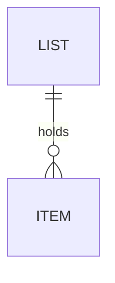

# Entity Model

## Entity Relationship Diagram

### LIST

The things to do next for one folder: the repository it sits in, or the folder itself outside a repository.

**Not:** todo list, board, backlog

| Attribute | Meaning | Type | Rules |
|-----------|---------|------|-------|
| scope | The folder the list belongs to: the root of the repository, or the folder itself; a longer location cannot keep a list (S-012) | Identifier | Unique, never reused |
| name | The last part of the scope, shown as the list's title | Text | Required |

### ITEM

One thing to do next, written as one line of free text, either still pending or done.

**Not:** task, todo, entry

| Attribute | Meaning | Type | Rules |
|-----------|---------|------|-------|
| list_scope | The LIST this item belongs to, given by the list it is kept in | Reference to LIST | Required |
| position | Its place among the items of its list, which decides what comes next; given by the order of the list, not written down | Number | Required, Min: 1 |
| text | What to do, as the user wrote it, on one line; empty only when written so by hand; no length limit is set (S-011) | Text | Required |
| status | Where it stands, kept as the mark of its line: open for Pending, crossed for Done | Choice of Pending, Done | Required |

**Lifecycle:** Pending → Done; Done → Pending

A LIST is meant to be one per scope; today two scopes that read the same once separators become dashes share one list (S-007).

**Constraints:** Within a list, (list_scope, position) is unique; the pending items come in the order they are to be done, and the done items newest first unless the user moves them (UC-004 BR-002).
